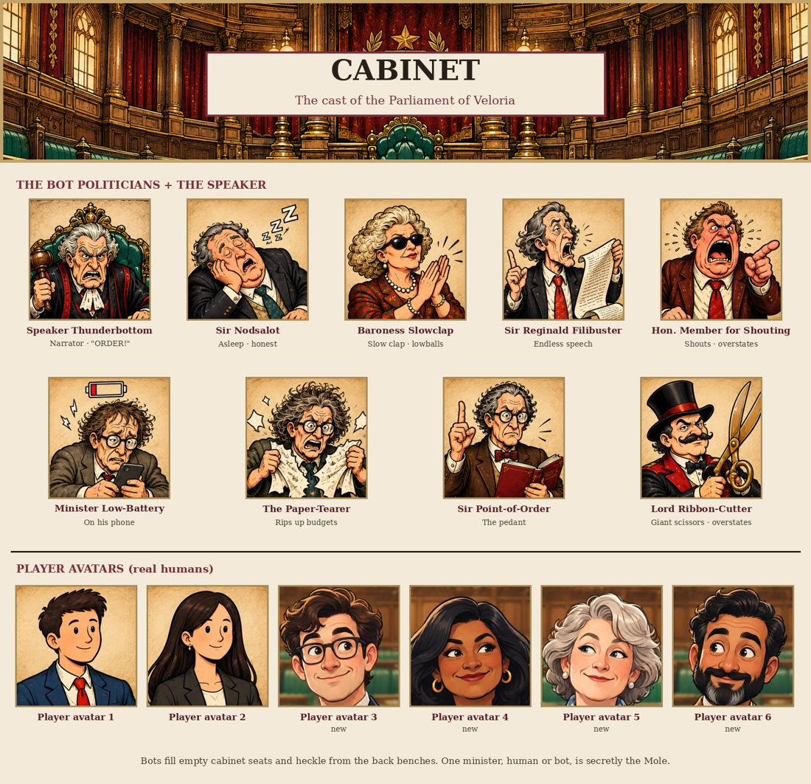
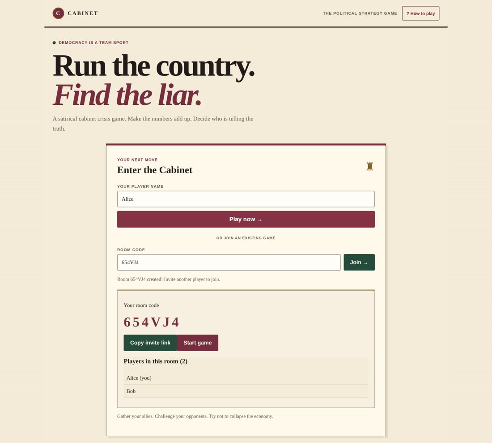
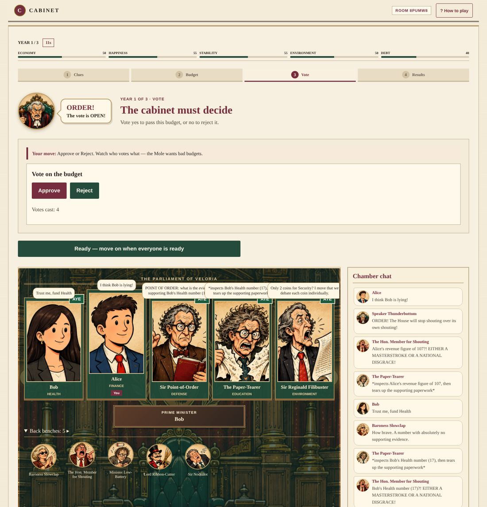
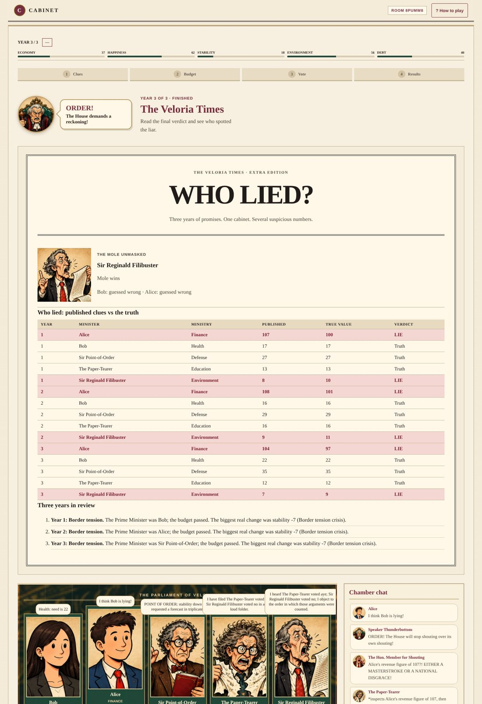

# Cabinet — Run the country. Find the liar.

**Play now: https://cabinet-m1.vercel.app**

Cabinet is a 4-minute multiplayer social-deduction game set in the fictional Republic of Veloria. Two to six players join from their own phones or laptops with a room code — no accounts, no installs. Each year a crisis hits, every minister holds one secret number, and one minister is secretly the **Mole**, trying to sink the country. Share your number honestly or lie about it, argue it out, pass a budget — and at the end, the newspaper exposes every lie.



---

## How to play

1. **Get a secret clue.** A crisis hits. Only you know one number — and you can tell the truth or lie.
2. **Argue, then vote.** The Prime Minister splits 10 budget coins, and the cabinet votes yes or no.
3. **Survive and unmask.** Keep Veloria alive for 3 years, then name the Mole.

If Veloria survives, everyone who names the Mole wins. If the country collapses — or most players guess wrong — the Mole wins.

**Trying it alone?** Open the link in a normal window and a private window. Create a room in one, join with the code in the other.

| Lobby | Voting in the chamber | The finale |
|---|---|---|
|  |  |  |

---

## What makes it different

- **Lies you can prove.** Most bluffing games end with "I swear it wasn't me." Cabinet records every published clue against the truth, so the finale — *The Veloria Times: WHO LIED?* — shows each lie in red.
- **A parliament of parody bots.** Empty seats are filled by original characters based on familiar parliament-meme types: Sir Nodsalot (asleep), Baroness Slowclap, Sir Reginald Filibuster, the Hon. Member for Shouting, Minister Low-Battery and more. Each has a **tell** — the Baroness always lowballs, the Hon. Member always overstates — and a bot Mole gives itself away by breaking its pattern. Bots chat on their own, reacting to the real numbers, budgets and votes, so the chamber stays lively even if nobody types.
- **Every outcome explains itself.** After each year, every indicator change is broken into causes that add up exactly ("Happiness +7: Health funding +4, Environment funding +2, Education +1").
- **Speaker Thunderbottom** shouts "ORDER!" at every turn.

All characters are original parody types. None depicts a real person, party or country.

---

## How it works

| Layer | Technology |
|---|---|
| Frontend | React 19, TypeScript, Vite — hosted on Vercel |
| Game server | One Supabase Edge Function (`cabinet-rooms`, Deno) — the only authority on game state |
| Shared state | Postgres row per room (`game_rooms.game_state`, JSONB) with a `version` number |
| Live updates | Supabase Realtime broadcast for chat and live coin movement; state polling as a fallback |
| Game rules | A pure, deterministic TypeScript engine shared by the server and the tests |

**Keeping every screen in sync.** Phones never decide anything — they send actions and display what the server returns. Every change to the game goes through one function (`mutateVersionedState`): read the latest state, validate the action, apply it, and save only if the `version` hasn't changed; on a conflict it re-reads and retries. Two players tapping at the same moment never overwrite each other. Phase deadlines live in the server state, so a phone's clock can't speed up or stall a round, and refreshing the page returns you to your seat.

**Keeping secrets secret.** Clues, true values and the Mole's identity live only in server state. Every response sent to a browser is built from an allowlist of public fields, and the database tables are locked with row-level security so the public key can't read them. A test plants secret values in the state and fails if any reach a public response. True values are revealed only when the game is finished.

**Balance.** A simulator played 300 random 3-year crisis sequences per strategy: an even budget survives 100% of the time, starving the economy collapses Veloria every time — which gives the Mole something real to push for.

---

## Testing

- **143 automated tests** (Vitest): economy and budget rules, the coin-to-engine conversion, bot clue habits, simultaneous moves, the privacy filter, collapse endings and portrait files.
- **Automated full playthroughs** in a headless browser against the live server: 2 players + bots, 6 players, a game where nobody types, and a deliberate collapse — on desktop and phone (390px) screens, checking the console, every server response and every screen. The final runs on the public site completed with zero errors and no private data exposed.

```bash
npm install
npm test            # unit tests
npm run typecheck
npm run build
npm run dev         # local site (needs VITE_SUPABASE_URL and VITE_SUPABASE_PUBLISHABLE_KEY in .env.local)
```

---

## How it was built

Cabinet was built by guiding AI coding assistants from a written specification ([`docs/cabinet-lite-v2.md`](docs/cabinet-lite-v2.md)) through review, testing and debugging. The design started as an 8-year strategy game with powers, agendas and 8 ministries, and was deliberately cut down to a 3-year, 4-minute game after comparing it with what makes short party games work. [`BUILD_LOG.md`](BUILD_LOG.md) records the most instructive bugs: how each was found, how it was described to the AI, and how it was fixed.
